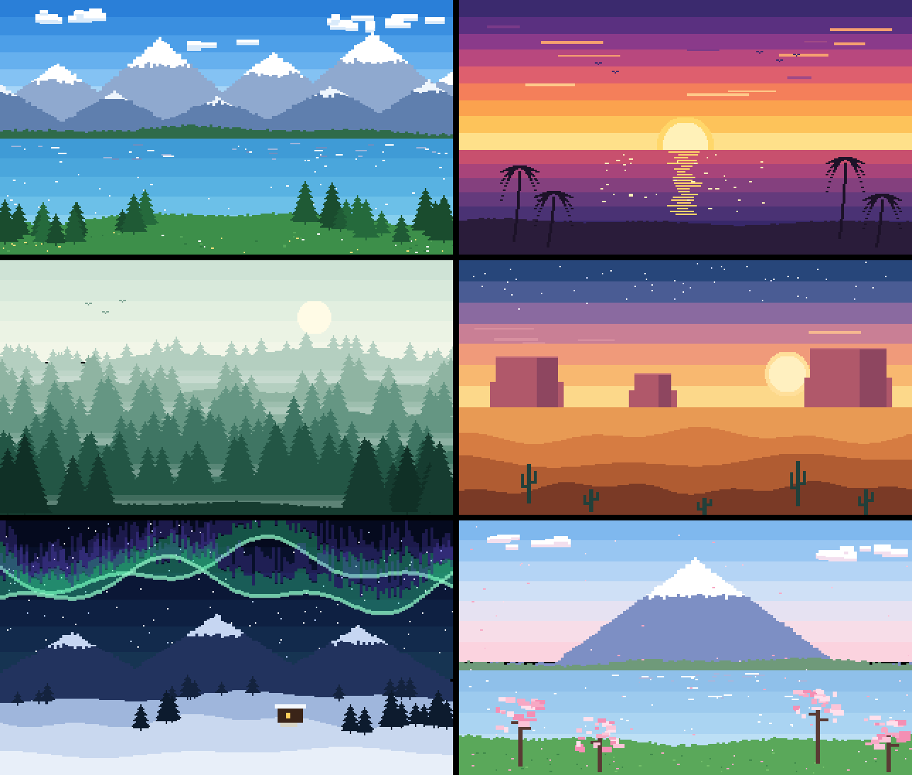
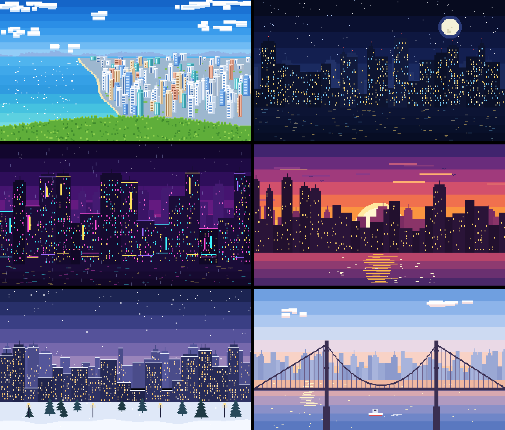
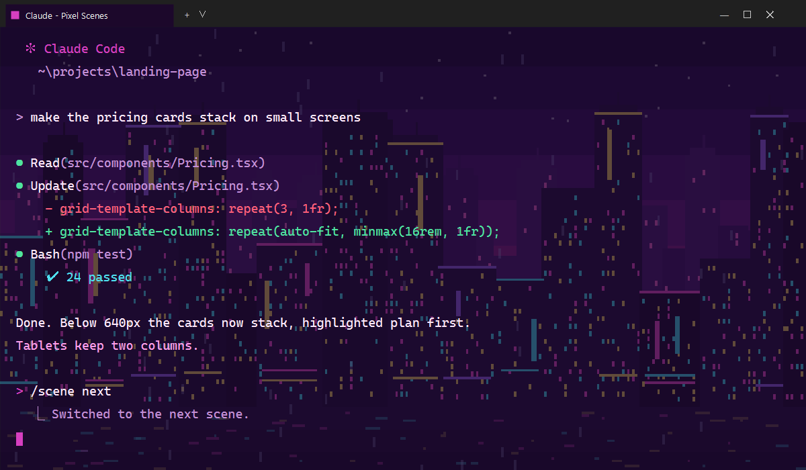
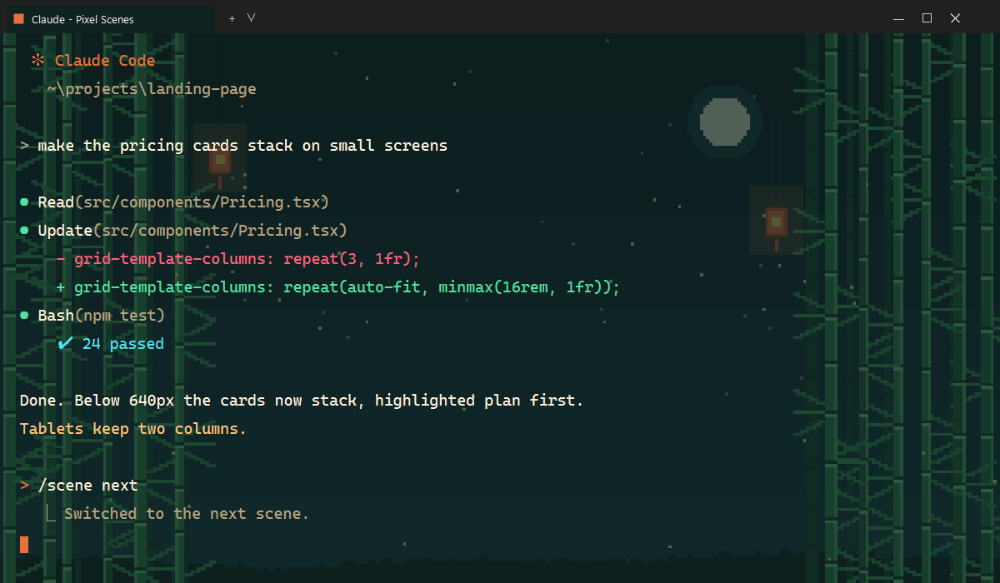
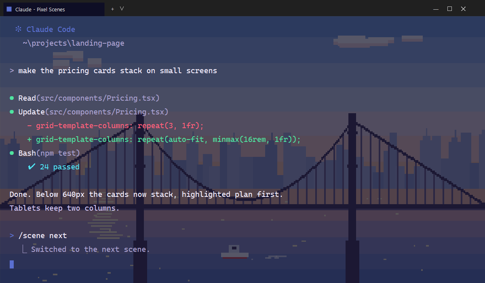
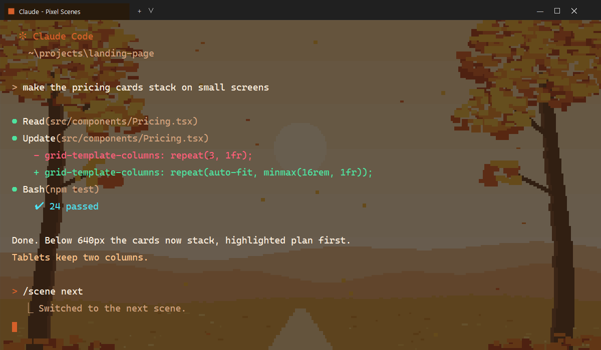

<h1 align="center">Pixel Scenes</h1>

<p align="center">
  <b>16 hand-drawn, animated pixel-art themes for Claude</b><br>
  for the Claude desktop &amp; mobile apps <i>and</i> Windows Terminal
</p>

<p align="center">
  
  
  
  
</p>

<p align="center">
  <a href="#-quick-start">Quick start</a> ·
  <a href="#-use-it-in-the-desktop-app">Desktop app</a> ·
  <a href="#-use-it-in-windows-terminal">Windows Terminal</a> ·
  <a href="#-the-16-scenes">Scenes</a> ·
  <a href="#-install-from-a-clone">Install from a clone</a> ·
  <a href="#-troubleshooting">Troubleshooting</a>
</p>

<p align="center"></p>

Every scene is drawn in code, pixel by pixel, and comes with its own color palette: background, text colors, accent and a glass panel tuned so the conversation stays readable. Nothing here is a photo or someone else's artwork.

---

## ✨ What you get

| | |
| --- | --- |
| 🎨 **16 scenes** | 6 landscapes, 6 cities and 4 side-framed scenes whose artwork stays at the edges |
| 🌧️ **Real animation** | drifting clouds, rain, snow, falling petals and leaves, neon signs, aurora, twinkling windows — CSS inside SVG, no scripts |
| 🖋️ **Text colors per scene** | in dark mode each scene has its own text: neon pink for `neon`, lantern amber for `tre-dem`, aurora green for `cuc-quang` |
| 🪟 **Adjustable glass** | `/scene glass 0` makes the panel behind the chat fully transparent; the scene then dims softly behind the text only |
| 💻 **Windows Terminal** | the same scenes and text colors as a terminal background, switched with the same `/scene` command |
| 💾 **Remembers your choice** | the scene and glass setting carry over to every new session |
| 🪶 **Small** | one hooks module and one script, no dependencies, no network access |

---

## 🚀 Quick start

**1. Install** — in a terminal with [Claude Code](https://claude.com/claude-code):

```bash
claude plugin install pixel-scenes --marketplace Thanh-Mathieu95/Theme-Claude
```

Answer `y` to **Add marketplace?**, then press Enter to keep the **user** scope (every session gets the theme).

> In the Claude desktop app instead: click **+** next to the prompt box → **Plugins** → **Add marketplace** → `Thanh-Mathieu95/Theme-Claude` → **Add plugin**.

**2. Open a new session** in the Claude desktop app (the **Code** tab). The default scene, `pho-bien`, appears right away.

**3. Pick a scene:**

```text
/scene          list all 16 scenes
/scene 9        switch by number
/scene neon     switch by name
```

That's it for the desktop app. For the terminal, see [Use it in Windows Terminal](#-use-it-in-windows-terminal).

---

## 🖥️ Use it in the desktop app

<p align="center"></p>

| Command | What it does |
| --- | --- |
| `/scene` | Lists the 16 scenes |
| `/scene <number or name>` | Switches scene, colors and text colors together |
| `/scene next` | Goes to the next scene in the list |
| `/scene glass 0` | Makes the glass behind the conversation transparent |
| `/scene glass 0.4` | Any strength from `0` (transparent) to `1` (solid) |
| `/scene glass auto` | Back to each scene's own strength |

The command's replies are written in Vietnamese; the scene names are the ones in [the list below](#-the-16-scenes).

**Light and dark mode.** Eight scenes have palettes for both modes. The other eight (`hoang-hon-bien`, `cuc-quang`, `pho-dem`, `neon`, `pho-hoang-hon`, `pho-tuyet`, `tre-dem`, `hem-pho`) are night scenes made for dark mode and ask the app to draw dark. The per-scene text colors apply in dark mode; light mode keeps dark text, which is what stays readable on light surfaces.

**Transparent glass.** At `/scene glass 0` there is no frosted panel at all. To keep text readable, the scene itself dims a little behind the chat column, fading out toward the edges — the brighter the scene, the more it dims, but never more than the scene's default glass would.

---

## 💻 Use it in Windows Terminal

<table>
  <tr>
    <td></td>
    <td></td>
  </tr>
  <tr>
    <td></td>
    <td></td>
  </tr>
</table>

<sub>Previews rendered from the real background images, image opacity and color schemes the plugin writes to Windows Terminal; not screen captures.</sub>

A terminal cannot draw a Claude theme, so the plugin brings the look another way: a Windows Terminal profile named **Claude - Pixel Scenes** with the scene as its background image and a color scheme built from the scene's palette. Its text colors are the same as in the desktop app.

### Set it up (once)

**1. Install the plugin** (see [Quick start](#-quick-start)).

**2. Ask Claude to set up the terminal.** Run `claude` in any terminal and say:

> Put the neon scene behind my Windows Terminal.

Claude lists the scenes if you don't name one, tells you what it will change, and asks before doing it.

**3. Open the profile.** Press <kbd>Win</kbd> + <kbd>R</kbd>, paste this and press Enter:

```text
wt -p "Claude - Pixel Scenes"
```

Or, in Windows Terminal, click the small **∨** next to **+** on the tab bar and choose **Claude - Pixel Scenes**. The tab starts `claude` on its own.

**4. (Optional) Make it the default.** Windows Terminal → **Settings** → **Startup** → **Default profile** → **Claude - Pixel Scenes** → **Save**.

### Every day

Inside that tab, `/scene 13`, `/scene neon` or `/scene next` switch **both** the background image and the text colors; the open tab changes at once. If you type `/scene` in a tab that uses another profile, it tells you and shows how to open the right one.

### What it changes on your PC

- Writes the scene as a 1920×1080 PNG to `%LOCALAPPDATA%\PixelScenes\`.
- Adds or updates **one** profile (**Claude - Pixel Scenes**) and **one** color scheme (`Pixel Scenes - <scene>`) in Windows Terminal's `settings.json`. No other profile or setting is touched.
- Backs up `settings.json` to `settings.json.bak-pixel-scenes` before its first change.

The terminal background is a still image; animation is a desktop-app feature, and `/scene glass` has no effect in a terminal.

### Without Claude

The skill is a small script you can run yourself with Node.js:

| Command | What it does |
| --- | --- |
| `node terminal-theme.mjs --list` | Lists the scenes |
| `node terminal-theme.mjs neon` | Applies a scene (name or number) |
| `node terminal-theme.mjs 9 --opacity 0.2` | Fainter image (default `0.3`) |
| `node terminal-theme.mjs --remove` | Removes the profile and its schemes |
| `node terminal-theme.mjs --export neon neon.png` | Only writes the image (any OS) |

The script is `skills/terminal-theme/terminal-theme.mjs` in this repository.

**macOS and Linux** have no Windows Terminal. Use `--export` to get the image and set it as your terminal's background by hand (iTerm2: **Settings → Profiles → Window → Background Image**).

---

## 🎨 The 16 scenes

<p align="center"></p>

| # | Name | Scene | Motion | Modes |
| --- | --- | --- | --- | --- |
| | **Landscapes** | | | |
| 1 | `ho-nui` | Snowy peaks over a mountain lake | clouds, sparkling water | light · dark |
| 2 | `hoang-hon-bien` | Sunset over the sea, palms | sparkling sun path | dark |
| 3 | `rung-suong` | Misty pine forest at dawn | breathing fog, birds | light · dark |
| 4 | `sa-mac` | Desert dunes and mesas at dusk | stars, clouds | light · dark |
| 5 | `cuc-quang` | Aurora over snowy hills, a cabin | pulsing aurora, stars | dark |
| 6 | `hoa-anh-dao` | Cherry blossoms by a lake | falling petals | light · dark |
| | **Cities** | | | |
| 7 | `pho-bien` | Coastal city from a green hill *(default)* | clouds, sparkling water | light · dark |
| 8 | `pho-dem` | Night skyline under a full moon | twinkling windows | dark |
| 9 | `neon` | Neon city in the rain | rain, neon signs | dark |
| 10 | `pho-hoang-hon` | Skyline against a setting sun | sparkling river | dark |
| 11 | `pho-tuyet` | Snowy city at dusk | falling snow | dark |
| 12 | `cau-cang` | Suspension bridge and harbor at sunrise | clouds, sparkling water | light · dark |
| | **Side-framed** — artwork at the edges, calm middle | | | |
| 13 | `tre-dem` | Bamboo grove with red lanterns | glowing lanterns, fireflies | dark |
| 14 | `hem-pho` | Lit towers framing a dusk sky | neon signs, string lights | dark |
| 15 | `thac-doi` | Twin waterfalls, lake, far peaks | shimmering falls, mist | light · dark |
| 16 | `la-thu` | Autumn maples framing a golden field | falling leaves | light · dark |

---

## 📦 Install from a clone

Prefer to keep a copy of the repository? Clone it and install from the folder:

```bash
git clone https://github.com/Thanh-Mathieu95/Theme-Claude
```

```bash
claude plugin marketplace add ./Theme-Claude
```

```bash
claude plugin install pixel-scenes@theme-claude
```

`theme-claude` is the marketplace name declared in this repository, so the plugin's full name is `pixel-scenes@theme-claude`. Choose the **user** scope when asked.

Then set up the terminal as in [Use it in Windows Terminal](#-use-it-in-windows-terminal), or straight from the clone:

```bash
node Theme-Claude/skills/terminal-theme/terminal-theme.mjs neon
```

**Try it without installing** (only for that one session):

```bash
claude --plugin-dir Theme-Claude
```

**Get a new version:**

```bash
git -C Theme-Claude pull
```

```bash
claude plugin marketplace update theme-claude
```

```bash
claude plugin update pixel-scenes@theme-claude
```

Restart Claude (or open a new session) to load it.

---

## 🛟 Troubleshooting

| You see | Do this |
| --- | --- |
| `/scene` is "unknown command" | The plugin loads in sessions started **after** installing. Open a new session. In the Claude app, use the **Code** tab — plugins don't run in the regular chat. |
| The desktop theme doesn't change | Open a new session after installing or updating. |
| The terminal background stays black | You're in a tab of another profile. Open **Claude - Pixel Scenes** (<kbd>Win</kbd>+<kbd>R</kbd> → `wt -p "Claude - Pixel Scenes"`). |
| `/scene` says the terminal has no profile yet | Ask Claude "put this scene behind my Windows Terminal" once. |
| The profile opens but `claude` is not found | Claude Code isn't on the PATH for `cmd.exe`. Edit the profile's command line in Windows Terminal settings. |
| Text is hard to read | Desktop: `/scene glass 0.5` or `/scene glass auto`. Terminal: re-apply with `--opacity 0.2`. |
| The script refuses `settings.json` | It has comments or trailing commas; the script won't rewrite them. Remove them via Windows Terminal → Settings → Open JSON file. |

**Things a theme cannot change:** fonts, the shape or borders of individual messages, and permission prompts (they always keep the app's own look).

---

## 🗑️ Uninstall

1. If you used the terminal profile, remove it first — ask Claude "remove the pixel scene from my terminal", or run `node terminal-theme.mjs --remove`.
2. Remove the plugin:

```bash
claude plugin uninstall pixel-scenes
```

To restore Windows Terminal's settings exactly as before the first change, copy `settings.json.bak-pixel-scenes` over `settings.json` in the same folder (this also undoes anything changed since).

---

## 🛠️ Make your own scene

All scenes live in [`hooks/scenes.js`](hooks/scenes.js), each a short function on a 320×180 pixel grid built from shared helpers (`bands`, `ridge`, `peaks`, `skyline`, `pines`, `clouds`, `twinkle`, `falling`, …). To add one, write a `scene(seed, () => { … })` function and add an entry to `THEMES`:

```js
{ id: 'my-scene', veil: 0.35, title: 'My scene', hue: 210, sat: 30, accent: '#2f7fd6',
  text: ['#eaf4ff', '#b8d6f2', '#8fb4d8'], draw: myScene },
```

| Field | Meaning |
| --- | --- |
| `id` | Name typed after `/scene` (letters, digits, `-`) |
| `title` | Shown in the list and used as alt text |
| `veil` | Default glass strength, `0`–`1`; brighter scenes need more |
| `tint` | Optional raw color for the glass (single-mode scenes only) |
| `hue`, `sat` | Tint of the app's grays |
| `accent` | Links, buttons, code keywords, terminal cursor |
| `text` | Optional dark-mode `[main, secondary, dim]` text colors, also used by the terminal |
| `only` | `'dark'` for a scene made for dark mode only |

Keep each scene's SVG under 131,072 characters.

### Develop

```bash
claude --plugin-dir Theme-Claude
```

`--plugin-dir` loads the plugin from the folder and reloads it as you edit. Check it with `claude plugin validate .`.

```text
.claude-plugin/plugin.json        plugin manifest
.claude-plugin/marketplace.json   makes this repository installable
hooks/register.tsx                /scene command, theme, glass, terminal switching
hooks/scenes.js                   the 16 scenes, palettes and text colors
hooks/make-colors.js              the app's color helper (copied, unmodified)
skills/terminal-theme/SKILL.md    the Windows Terminal skill
skills/terminal-theme/terminal-theme.mjs   its script
docs/                             images for this README
```

---

## 📄 License

[MIT](LICENSE) © Nguyen Duong Cong Thanh. The pixel art is original work and covered by the same license.
