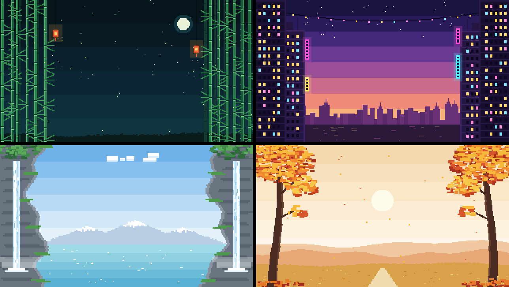
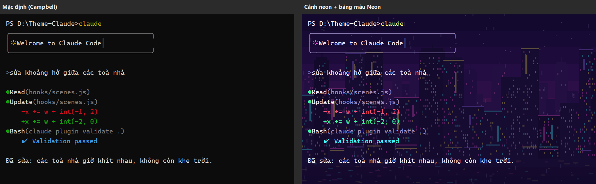

# Pixel Scenes — animated pixel-art themes for Claude

Sixteen hand-drawn, animated pixel-art backdrops for the Claude desktop and mobile apps. Each scene comes with its own matching color palette and a frosted veil tuned so text stays readable. Switch between them with one command: `/scene`.

It also ships a **skill** that puts the same scenes behind **Windows Terminal**, so Claude Code in the terminal gets the look too.

Everything in this repository is original. The scenes are drawn in code, pixel by pixel — no photos or artwork from anyone else.




The screenshots are still frames. In the app the scenes move.

## Contents

- [Features](#features)
- [Requirements](#requirements)
- [Install](#install)
- [Usage](#usage)
- [The 16 scenes](#the-16-scenes)
- [Windows Terminal (skill)](#windows-terminal-skill)
- [Readability and accessibility](#readability-and-accessibility)
- [Limitations](#limitations)
- [Customizing](#customizing)
- [Development](#development)
- [Uninstall](#uninstall)
- [License](#license)

## Features

- **16 scenes in three groups**: 6 landscapes, 6 cities, and 4 "side-framed" scenes whose artwork sits at the left and right edges so the conversation never covers it.
- **Real animation**: drifting clouds, sparkling water, falling snow, rain, petals and leaves, pulsing neon signs and aurora, twinkling stars and windows. All of it is CSS inside the SVG — no scripts.
- **A color palette per scene**: the app's surfaces, text and accent color are tinted to match the scene. Ten scenes support both light and dark mode; six night scenes are dark-only.
- **A veil tuned per scene**: the frosted panel behind the conversation has its own strength for every scene, measured from how bright that scene is. Night scenes also tint the veil with their own color.
- **Your choice persists**: the scene is saved and restored in every new session.
- **A Windows Terminal skill**: ask Claude to theme your terminal and it sets a Windows Terminal profile to any of the 16 scenes, with a matching color scheme. See [Windows Terminal (skill)](#windows-terminal-skill).
- **Small and self-contained**: one hooks module, no dependencies, no network access. The largest scene is about 87 KB of SVG.

## Requirements

- **Claude desktop app or Claude mobile app** to see the themes. A recent version with plugin (mod) support is required.
- **Claude Code** to install the plugin (the install command runs at a Claude Code prompt).

The terminal and editor extensions do not draw plugin themes. The plugin loads there without errors, but nothing changes visually. For the terminal, use the [Windows Terminal skill](#windows-terminal-skill) instead.

## Install

At the prompt of a Claude Code terminal session:

```
/plugin install pixel-scenes --marketplace Thanh-Mathieu95/Theme-Claude
```

Or from a shell:

```
claude plugin install pixel-scenes --marketplace Thanh-Mathieu95/Theme-Claude
```

You will be asked two things:

1. `Add marketplace?` — answer `y`. This adds this repository as a plugin source.
2. A scope — press Enter to accept the **user** scope, which makes the theme available in every session.

In the desktop app, where `/plugin` does not run: click **+** next to the prompt box, choose **Plugins**, **Add marketplace**, enter `Thanh-Mathieu95/Theme-Claude`, then **Add plugin**.

After installing, start a new session in the desktop app. The default scene (`pho-bien`, the coastal city) appears right away.

## Usage

Type these in the message box of a session:

| Command | What it does |
| --- | --- |
| `/scene` | Lists all 16 scenes |
| `/scene 9` | Switches to scene number 9 |
| `/scene neon` | Switches to a scene by its name |
| `/scene next` | Switches to the next scene in the list |

In a terminal, `/scene` also switches the Windows Terminal background once the [terminal profile](#windows-terminal-skill) is set up.

The command's replies are written in Vietnamese; the scene names below are the ones you type.

## The 16 scenes

"Modes" says which app color modes the scene has a palette for. A dark-only scene asks the app to draw in dark mode.

### Landscapes

| # | Name | Scene | Motion | Modes |
| --- | --- | --- | --- | --- |
| 1 | `ho-nui` | Snowy peaks over a mountain lake, pine forest | drifting clouds, sparkling water | light + dark |
| 2 | `hoang-hon-bien` | Sunset over the sea, palm silhouettes | sparkling sun path | dark |
| 3 | `rung-suong` | Misty pine forest at dawn | breathing fog, drifting birds | light + dark |
| 4 | `sa-mac` | Desert dunes and mesas at dusk | twinkling stars, drifting clouds | light + dark |
| 5 | `cuc-quang` | Aurora over snowy hills and a cabin | pulsing aurora, twinkling stars | dark |
| 6 | `hoa-anh-dao` | Cherry blossoms by a lake under a snowy peak | falling petals, sparkling water | light + dark |

### Cities

| # | Name | Scene | Motion | Modes |
| --- | --- | --- | --- | --- |
| 7 | `pho-bien` | Coastal city seen from a green hill (default) | drifting clouds, sparkling water | light + dark |
| 8 | `pho-dem` | Night skyline under a full moon, reflected in water | twinkling windows and stars | dark |
| 9 | `neon` | Neon city in the rain | falling rain, pulsing neon signs | dark |
| 10 | `pho-hoang-hon` | Skyline silhouette against a huge setting sun | sparkling river | dark |
| 11 | `pho-tuyet` | Snowy city at dusk, street lamps, pines | falling snow | dark |
| 12 | `cau-cang` | Suspension bridge and harbor at sunrise | drifting clouds, sparkling water | light + dark |

### Side-framed scenes

The artwork is concentrated at the left and right edges; the middle is a calm sky, so the conversation covers nothing.

| # | Name | Scene | Motion | Modes |
| --- | --- | --- | --- | --- |
| 13 | `tre-dem` | Bamboo grove at night with two red lanterns | glowing lanterns, fireflies | dark |
| 14 | `hem-pho` | Two rows of lit towers framing a dusk sky | pulsing neon signs, blinking string lights | dark |
| 15 | `thac-doi` | Twin waterfalls on rock cliffs, lake and far peaks | shimmering falls, mist, clouds | light + dark |
| 16 | `la-thu` | Two autumn maples framing a golden field | falling leaves | light + dark |

## Windows Terminal (skill)

A terminal cannot draw a plugin's theme, so the plugin includes a skill, **terminal-theme**, that gives Windows Terminal the same look another way: it sets one Windows Terminal profile, **Claude - Pixel Scenes**, to use a scene as its background image with a color scheme made from the scene's palette.



*Left: Windows Terminal's default. Right: the `neon` scene and its color scheme. A mock-up drawn with the same colors and image strength.*

### Use it

Once the plugin is installed, just ask Claude, in any session:

> Put the neon scene behind my Windows Terminal.

> Change my terminal to the waterfall scene.

> Remove the pixel scene from my terminal.

Claude lists the scenes if you don't name one, tells you what will change, and runs the script. Then, in Windows Terminal, click the **▾** next to **+** on the tab bar and choose **Claude - Pixel Scenes**. The tab starts `claude`. To make it the default: **Settings › Startup › Default profile › Claude - Pixel Scenes › Save**.

### What it changes

- Writes the scene as a 1920×1080 PNG to `%LOCALAPPDATA%\PixelScenes\`.
- Adds or updates **one** profile (**Claude - Pixel Scenes**, fixed GUID, never duplicated) and **one** color scheme (`Pixel Scenes - <scene>`) in Windows Terminal's `settings.json`. Nothing else is touched.
- Backs up `settings.json` to `settings.json.bak-pixel-scenes` before its first change.
- Windows Terminal reloads its settings by itself, so an open tab on that profile changes at once.

The terminal image is still: animation is a desktop-app feature.

**Switching scenes in the terminal.** Once the profile exists, typing `/scene <name or number>` inside a Claude Code session in the terminal switches the Windows Terminal background as well, and the open tab changes at once. Before the profile exists, `/scene` in the terminal changes nothing there and tells you to ask Claude to set it up first.

### Run the script yourself

The skill is a thin wrapper around `skills/terminal-theme/terminal-theme.mjs`. You can run it directly with Node.js:

| Command | What it does |
| --- | --- |
| `node terminal-theme.mjs --list` | Lists the 16 scenes |
| `node terminal-theme.mjs neon` | Applies a scene (by name or number) |
| `node terminal-theme.mjs 9 --opacity 0.2` | Same, with a fainter image (default 0.3) |
| `node terminal-theme.mjs --remove` | Removes the profile and its color schemes |
| `node terminal-theme.mjs --export neon neon.png` | Only writes the background image (any OS) |

### Other terminals and platforms

Windows Terminal is Windows only. On macOS or Linux, use `--export` to get the image and set it as your terminal's background by hand (for example iTerm2: **Settings › Profiles › Window › Background Image**).

### Undo

- Remove only what the skill added: ask Claude, or run `--remove`.
- Restore the settings exactly as they were before the first change: copy `settings.json.bak-pixel-scenes` over `settings.json` in the same folder. This also undoes any other change made since.

The script refuses to rewrite a `settings.json` that has comments or trailing commas, rather than lose them.

## Readability and accessibility

- **Veil strength is measured, not guessed.** For each scene, the opacity of the frosted panel behind the conversation was chosen from the contrast between the theme's text colors and the brightest (or darkest) parts of the scene behind it.
- **Reduced motion is respected.** If your operating system is set to reduce motion, every scene is drawn still.
- **Animation is deliberately slow and small.** Clouds take 90 seconds to drift a few pixels; only the rain in `neon` is fast.
- **Each scene has alt text** describing it.
- **Palettes are checked.** Every palette is generated with the app's own color helper and verified to be one the desktop app will paint.

## Limitations

- **Fonts cannot be changed.** A Claude theme controls colors and the backdrop only.
- **The terminal and editor extensions draw no plugin theme.** In Windows Terminal, use the [skill](#windows-terminal-skill); its background is a still image.
- **Bright daytime scenes in dark mode.** `ho-nui`, `hoa-anh-dao`, `pho-bien`, `cau-cang`, `thac-doi` and `la-thu` have bright skies. Their veil is kept lighter than strict contrast would ask for, so the middle of the window is not a dark slab; white text over the brightest patches is weaker there. They read best in light mode.
- **Narrow windows crop the sides.** Scenes are scaled to fill the window, so a tall, narrow window cuts off the left and right edges — which is where the side-framed scenes keep their artwork.
- **Permission prompts keep the app's own look.**
- **Command replies are in Vietnamese.**

## Customizing

All scenes live in one file, [`hooks/scenes.js`](hooks/scenes.js). Each is a short function built from shared helpers (`bands`, `ridge`, `peaks`, `skyline`, `pines`, `clouds`, `twinkle`, `falling`, …) on a 320×180 pixel grid.

To add a scene:

1. Write a new `scene(seed, () => { … })` function in `hooks/scenes.js`. Keep the SVG under 131,072 characters.
2. Add an entry to the `THEMES` array at the bottom of that file:

   ```js
   { id: 'my-scene', veil: 0.5, title: 'My scene', hue: 210, sat: 30, accent: '#2f7fd6', draw: myScene },
   ```

   | Field | Meaning |
   | --- | --- |
   | `id` | The name typed after `/scene` (letters, digits, `-`) |
   | `title` | Shown in the list and used as alt text |
   | `veil` | Opacity of the panel behind the conversation, 0 to 1. Brighter scenes need more |
   | `tint` | Optional raw color for the veil. Only for single-mode scenes, since it does not follow light/dark |
   | `hue`, `sat` | Hue and saturation of the app's tinted grays |
   | `accent` | The accent color (links, buttons, code keywords) |
   | `only` | `'dark'` for a scene made for dark mode only |

To change the veil blur for every scene, edit `glass: { blur: 12, … }` in [`hooks/register.tsx`](hooks/register.tsx). To change the default scene, edit `DEFAULT` in the same file.

## Development

```
git clone https://github.com/Thanh-Mathieu95/Theme-Claude
claude --plugin-dir Theme-Claude
```

`--plugin-dir` loads the plugin straight from the folder and hot-reloads it as you edit.

| Task | Command |
| --- | --- |
| Validate the manifest and hooks module | `claude plugin validate .` |
| Type-check (after the engine has loaded the plugin once, which writes its types) | `npx -p typescript tsc -p .` |

Repository layout:

```
.claude-plugin/plugin.json        plugin manifest
.claude-plugin/marketplace.json   makes this repository installable
hooks/hooks.json                  names the hooks module
hooks/register.tsx                /scene command, theme, backdrop hook
hooks/scenes.js                   the 16 scenes, palettes and scene list
hooks/make-colors.js              the app's color helper (copied, unmodified)
skills/terminal-theme/SKILL.md    the Windows Terminal skill
skills/terminal-theme/terminal-theme.mjs   its script
docs/*.png                        preview images for this README
```

## Uninstall

```
/plugin uninstall pixel-scenes
```

The app's own look returns in the next session. If you used the Windows Terminal skill, remove its profile first (ask Claude, or run `terminal-theme.mjs --remove`).

## License

[MIT](LICENSE) © Nguyen Duong Cong Thanh. The pixel art is original work and are covered by the same license.
